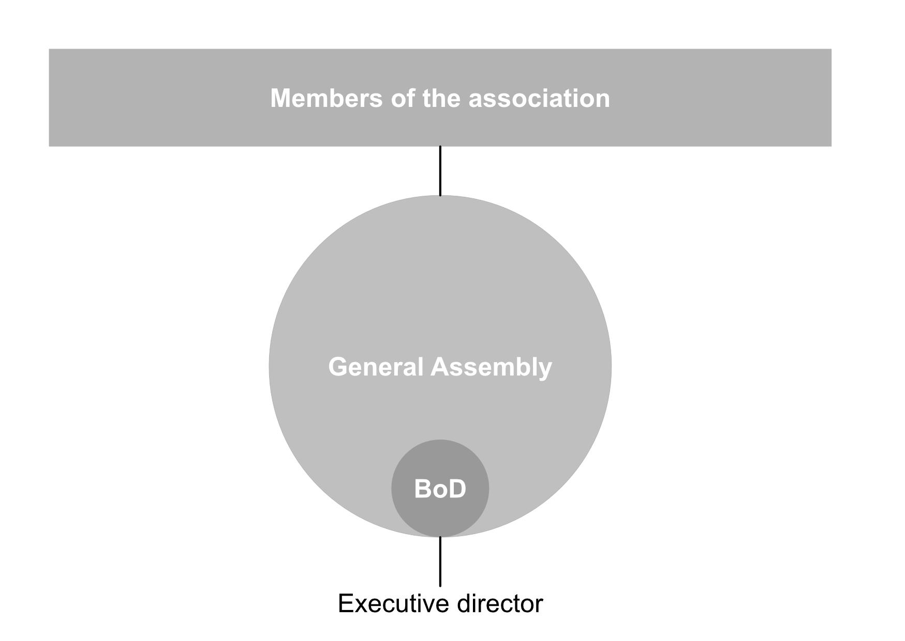
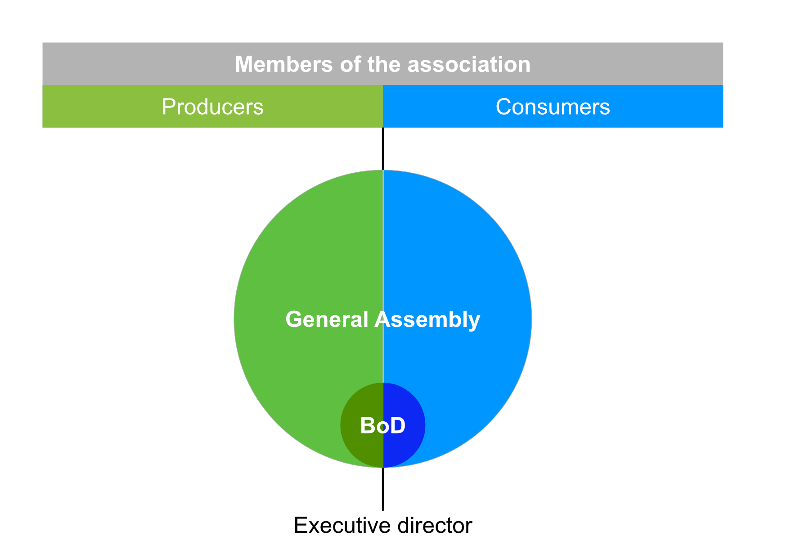
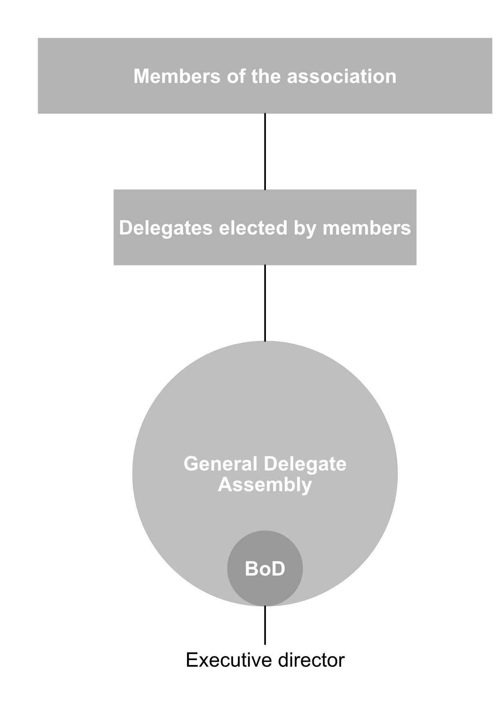
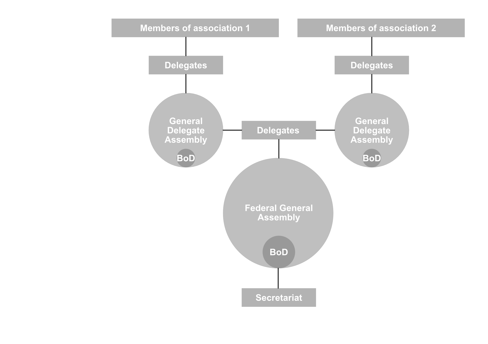
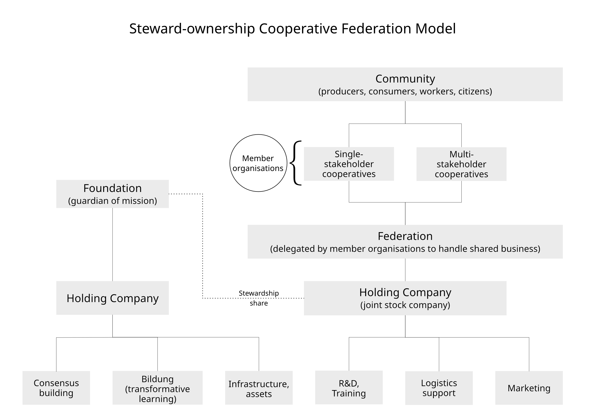

This chapter sets out the organisational structures that would be required to support a hypothetical Hansalim-style movement of multi-stakeholder cooperation in Europe.

## Executive Summary {.unnumbered}

First,  I explain how associations and federations can provide the context for democratic and deliberative decision making based on consensus building.
By working on the principle of ‘one-member-one-vote’ no single person can easily gain control of the organisation to disrupt its mission and responsibility for realising that mission is not borne by one person alone but shared among all its members.
To ensure proper representation the highest level of decision making is the General Assembly (GA) of all members (or delegates elected by all members).
The GA elects a Board of Directors (BoD) to take decisions over issues delegated to them and they in turn may appoint executive officers to run the day-to-day business of the association.

Second, I explain the potential threats to democratic organisation which need to be defended against. These include:

1. **Movement degeneration** in which the purpose drifts from the original intention i.e. from non-profit to profit-oriented or from local focus to international export focus;
2. **Entryism** which means capture by vested interests, political groups or bad-faith actors who organise to manipulate the association’s democratic processes to take over control;
3. **Stakeholder bias:** the natural trend towards domination by one stakeholder group (i.e. most likely consumers).
4. **Organisational bias**: domination by larger member associations.
5. **Tyranny of the majority:** the subordination of minority interests by the majority (an extreme version of 3 and 4 above).
6. **Founders syndrome** in which the organisation becomes unhealthily dependent upon its charismatic founder.

Third, I describe several strategies to hold on to the mission and defend against these threats. These include:

- Creating a federation through which member organisations can hold each other accountable;
- Separating business activities from asset ownership and creating a steward-ownership structure;
- Ensuring balanced representation of different stakeholders in the General Assembly and on the Board of Directors;
- Designing democratic processes and giving the foundation the responsibility for coordinating them;
- Focusing on education and relationship building through 'bildung';
- Creating a democratic culture.

Fourth, to provide a flexible way to manage capital, I recommend that associations adopt the cooperative form of organisation because it makes membership conditional upon owning shares in the cooperative which provides the cooperative with start up capital.
Additional mechanisms  for raising capital include the issuing of internally tradable shares alongside membership shares, flexible allocation of surplus paid to interest on capital and dividends, and member loans.

Fifth, I outline the legal forms required to implement this structure in different countries in Europe and, in a series of appendices, I present the necessary clauses that should be included in the articles of association for each type of organisation.

## Organising a movement

To create a different kind of food system, a different kind of organisation is required that gives control to everyone involved.
A privately owned company will not work.
To give control to members, an association is what is needed. 
Associations can take various forms, including cooperatives, friendly societies, clubs etc.
But essentially, an association is an organisation controlled by its members for the benefit of its members.
All its members will have equal voting rights to determine how it is operated.

An association will usually have a General Assembly (GA) and a Board of Directors (BoD) (@fig-basic-association).
The GA is a formal meeting of all the association’s members and holds the highest authority in the organisation.
It is held at least once per year to sign off the financial accounts for the previous year, agree a budget for the coming year and decide on strategy and other issues related to the management of the organisation.
The BoD are elected from among the members at the GA.
Their responsibility is to oversee the management of the Association and they are under the authority of the GA.
They usually meet once per month.
The BoD may appoint an executive director to act as the manager who takes care of the day-to-day business on behalf of the BoD.
In simplest terms, this is the structure of an association or cooperative and it is the structure adopted by Hansalim from the beginning.

:::: {layout-nrow="1"}

::: {#fig-basic-association}

Basic structure of an association (authority flows from top to bottom of diagram

:::

::: {#fig-basic-multistakeholder}

Basic structure of a multi-stakeholder association (authority flows from top to bottom of diagram

:::

::::

Associations are normally formed by a group of people who share a common interest.
For example dairy farmers might form a producer cooperative, crafts people a worker cooperative and consumers a consumer cooperative. 
However, it is also possible for people with different interests to form an association.
This is called a multistakeholder association (@fig-basic-multistakeholder).
For example if farmers and consumers form an association the organisation would be a producer-consumer multi-stakeholder association or cooperative.

There are several advantages of a structure like this.
The first is that it doesn’t rely on one single person such as a lone entrepreneur.
This means that the responsibility and burden for keeping the business running does not rest on one person’s shoulders but can be shared among a larger number of people.
The second advantage is that it gives an equal voice to everyone in the organisation so that one person’s opinion or interests cannot dominate those of others.
Finally, it protects against takeover by anyone who would want to buy a controlling share because there is no controlling share.
Each member gets just one vote in the GA regardless of how many shares they own.

There are also disadvantages.
First, to be successful, an association needs an active membership who are committed to participating in the decision making process at the GA, running for election to the BoD, and who take an educated interest in the business and management of the association.
If the membership are passive, an association will operate similarly to any other kind of commercial organisation and likely end up focused on very narrow business interests.
Second, it can be difficult to scale up an association.
As membership grows so does the number of people involved in decision making at the GA.
If a meeting has hundreds of people trying to get their point across at the same time it is likely to very chaotic and very, very long.

There is a well tested solution to the second disadvantage.
That is a delegate GA (@fig-delegate-association).
Instead of all members of the association attending the GA, the members elect delegates to attend the GA and to deliberate and vote on their behalf.
In this way, the GA can be kept small enough so that decisions can be properly debated while all members are represented equally and can convey their opinions through people delegated to carry them to the GA.
This is the structure Hansalim uses for its 30 Consumer Life Cooperatives which range in membership from 7,000 to 90,000 each.

::: {#fig-delegate-association}

{style="max-height: 500px;"}

Delegate structure of an association.

:::

What happens when you start a second association, and a third and fourth? 
How will each association relate to the others? 
How can they organise joint activities and shared business?
This is where a federated structure can help.

A federation is an association formed of separate organisations, each of which remains independent in terms of its own internal affairs.
In this case, the members are not individual people but organisations or associations of people.
Authority in a federation is delegated from the member organisations to a Federal General Assembly (FGA) who elects a BoD and can establish a Secretariat which answers to the BoD (@fig-federal-association).
The Secretariat is an executive office that carries out the day-to-day business of the Federation and may be led by a paid executive officer.

::: {#fig-federal-association}

Federation of associations structure.

:::

Hansalim is in fact a federation of federations!
Hansalim producers form their own associations which form up into regional producer federations.
These then form a national federation called the Hansalim Producer Federation.
The 30 Consumer Life Cooperatives and the Hansalim Producer Federation together created the Hansalim Cooperative Federation.
This body oversees the work of the Hansalim Business Federation, a joint stock company, which manages all the shared business of all of the Hansalim member organisations.
That includes distribution and logistics, production planning, marketing, and organising the numerous other activities and committees that are vital to Hansalim’s mission.

These structures are the tried and tested ways of organising long term collective action and cooperative economic activity.
Cooperatives founded over 100 years ago are still operating today in countries all over the world.
If you want to create a lasting movement for social and economic change, these are the structures you need.
The next question, however, is how do you make sure that the mission of your association and your federation does not get diluted or changed into something never intended at that start?
This is where the details become important.

## Holding on to the mission

The cooperative movement that began in the mid-nineteenth century established seven principles that they thought should define a healthy cooperative.
These are:

1. Voluntary and open membership;
2. Democratic control by members;
3. Economic participation of members;
4. Autonomy and independence;
5. Provision of education, training and promotion;
6. Co-operation among co-operatives;
7. Contribution to the community.

These principles have helped to keep the ideals of the cooperative movement alive, but they were not enough to prevent the so-called “degeneration” of cooperatives into more commercially-oriented self-serving businesses.
There are various threats to democratic organisations such as cooperatives and associations which regular companies don’t have to deal with.

These are:

1. **Movement degeneration** in which the purpose drifts from the original intention i.e. from non-profit to profit-oriented or from local focus to international export focus;
2. **Entryism** which means capture by vested interests, political groups or bad-faith actors who organise to manipulate the association’s democratic processes to take over control;
3. **Stakeholder bias**: the natural trend towards domination by one stakeholder group (i.e. most likely consumers).
4. **Organisational bias**: domination by larger member associations.
5. **Tyranny of the majority**: the subordination of minority interests by the majority (an extreme version of 3 and 4 above).
6. **Founders syndrome** in which the organisation becomes unhealthily dependent upon its charismatic founder.

These threats can destroy a movement and the risks increase as the movement grows and gains more attention from political and private interest groups who may feel threatened or tempted by what they see as an opportunity to be exploited.
To protect against these threats we need to include some additional features in our association design which go beyond the seven cooperative principles.
And these should be written into the Articles of Association (AoA).
The AoA provide the legally protected rules by which the association operates and getting these right is vital to ensuring the healthy development of the association.
Luckily, Hansalim considered these issues back in the 1980s when they started out and they built them into their own organisational design.
They also learnt from their mistakes as they went along.
To gain the best head start in designing the structure of your association and its future federation you could start with an AoA adapted from Hansalim’s organisations (see appendix 4).
I have also suggested additional features that could strengthen the defence against the 6 threats listed above.
The next section gives an outline of the structure and processes I have designed to preserve the mission of your movement and protect its independence and democratic character.

## The federal steward-ownership structure

The defensive structure I have devised combines the democratic character of an association with a steward-ownership model.[^steward-ownership]
It is what I call a federal steward-ownership structure.
Figure @fig-federation-stewardship shows each of the organisations and how they related to each other.
The community is at the top because it is the people who are the owners of the member cooperatives and therefore, also owners of the federation.
They form single or multi-stakeholder cooperatives to operate non-profit businesses in food, farming and other sectors such as social care, education etc. which provide goods and services to members.
The member organisations form a federation which is delegated by them to handle shared business activities.
The foundation is the guardian of the mission of the federation and its members.
In the following section I describe in detail the organisational structure and explain how it protects against the threats outlined above.
The overall goal is to give member cooperatives the maximum level of autonomy while protecting their shared activities from mission drift and corporate raiders.

::: {#fig-federation-stewardship}

  

Steward-ownership Cooperative Federation Model.

:::

[^steward-ownership]: Sharetribe in Finland is a good example of the steward-ownership model. It issued a ‘Golden Share’ to the Purpose Foundation (Purpose-Schweiz) in Germany which carries no economic value but holds a veto right over changes to the company’s articles of association that would violate its steward-ownership principles. This preserves the company’s asset lock so it cannot be sold to an investor or taken public (IPO) and ensures that its steward-ownership structure cannot be changed. (https://steward-ownership.community/companies/sharetribe-oy). Crowd Container is a Swiss example in the food sector. 

### Autonomy and accountability

Member cooperatives should be free to organise their own business activities however they wish and to modify their articles of association in whichever way the want within specified limits.
This maximum level of freedom is necessary to enable organisational innovation and adaptation to changing social and economic conditions.
To balance local autonomy against accountability, the federation should have no power to dictate to member organisations except in a very narrow set of circumstances specified in the federation articles of association under which the federation may expel a member organisation for specific violations.
These violations are:
 1. Amendments to the articles of association pertaining to:
    1. any change to the member cooperative's mission which deviates from the purpose of the Federation,
    2. any change to the voting structure which disadvantages one stakeholder group,
    3. removal of the asset lock,
    4. changes to the core operational definitions which contravene the purpose of the Federation.
2. Demutualisation by conversion of the member cooperative to a limited company.
3. Changes to the criteria for admitting new members to the cooperative if such changes are detrimental to the Federation's purpose.
4. Failure to meet financial obligations.
5. Actions against the federation's principles.

This provides the first line of defence by creating a way for member organisations to hold each other accountable to the mission they have agreed to participate in.
Membership of the federation is the gateway to accessing the services and branding of the your movement through a contractual franchise model.
Federation membership is gained by signing an Affiliation Agreement which mandates the member organisation includes specific articles in their AoA.
These would include the asset lock and rules stating the circumstances under which membership can be revoked by a vote of the other Federation members.
This helps to protect against threat 1 (movement degeneration) and threat 2 (entryism) because if one member organisation is captured and tries to demutualise or remove the asset lock, the other member organisations have the legal justification for expelling them from the Federation.

### Separation and stewardship

The second line of defence is to strictly protect the business activities shared by member organisations from interference by corporate raiders, demutualisation attempts and entryism through a steward-ownership model.
The mechanism for such protection is to separate the shared tradable assets (infrastructure, software, IP, brand identity etc.) from the shared business operations (processing, delivery, marketing, HR) and place each in its own distinct holding company secured by a stewardship share.
The ***asset holding company*** would be owned wholly by the foundation and the ***operations holding company*** would be a joint stock company owned by the federation and its members with a stewardship share held by the foundation.
This joint stock company would then lease the necessary assets from the foundation's holding company in order to carry out its business activities such as logistics support, marketing, R&D and training.
This does not preclude member cooperatives from owning their own assets for use in their own business activities but simply puts the shared assets into a cast iron asset lock so that they cannot be captured by external actors.
In this model, the foundation is legally bound to use the movement's assets for its stated mission and cannot sell them.
The federation's joint stock company is protected from hostile take-over or mission drift by the stewardship share which gives the foundation a veto on selling out or changing the purpose of the business from non-profit to for-profit.
While the federation and its secretariat are responsible for the shared business activities, the foundation is responsible for securing its assets and for carrying out the wider mission of the movement.

The stewardship share is designed to be a light touch measure which gives the foundation the right to veto changes to the joint stock company's articles of incorporation only in the relation to the following:

1. Changing the statement of purpose;
2. Removing the asset lock;
3. Selling the company's assets;
4. Changing core operational definitions (e.g. “local”, “ecological”);
5. Introducing rules that disadvantage one stakeholder group.
6. Changing the articles pertaining to the stewardship share.

In reality, the veto will probably never be used because its potential use should be enough to deter any attempt at a take-over.

### Representation

The third defence is in how delegate seats are allocated and in the composition of the board of directors in each cooperative and at the federation level.
By creating different types of shares for different types of stakeholders (e.g. consumer, producer, worker) it is possible to allocate delegate seats to each stakeholder group separately.
This way, you can ensure that all stakeholders are represented at the GA without any one stakeholder group dominating the others.
In addition, you can specify that the BoD includes directors from each stakeholder group to ensure that day-to-day decision making takes account of the interests and knowledge of each group.

The **founding board** of each member cooperative and the federation should consist of four types of director as follows:

- 1 Founder: a seat for the founder for a limited number of years (e.g. 5-10 years), after which time it becomes an ‘Elder’s Seat’ elected by the GA from a pool of former board members with significant experience.
- 3 Organisational: three seats elected by and from the GA as a whole or from among the member cooperatives' chair persons (for the Federation’s BoD).
- 1 Independent: a seat for an independent trusted expert invited by the board of directors (this could be one of the directors of another member association of the federation or a movement outsider with a shared interest).
- 3 Stakeholder: one seat for each stakeholder group (producer, employee, consumer) elected by and from the GA. In the case of two stakeholders, two seats would be allocated to the larger group and one to the smaller. In the case of a single stakeholder cooperative these would be an additional three seats identical to the organisational seats.

A board of 8 is a good number for in-depth deliberation and nuanced decision making.
It is large enough to make room for a diversity experience and knowledge while being small enough for thorough debate.
This board composition means that, at each directors’ election there will be 2 seats up for election, one Organisational Directorship and one Stakeholder Directorship.

The founder would initially hold the chair of the board of directors for a fixed period of time (e.g. 5 years) after which it would transition to an elected chair.
From this point on, the chair would be elected for 3 year terms with a maximum of two consecutive terms.
Together, these measures defend against threat 3 (stakeholder bias), 4 (organisational bias), and 5 (tyranny of the majority).

The foundation’s BoD would include the movement founder as chair for its first 10-15 years, after which it would become an ‘Elder’s seat’ appointed by the incumbent founder or elder.
Either the founder/elder’s seat could automatically hold the position of chair of the board or the board could elect a chair from among their number.
The other board members would include three elected by the various stakeholders of the federation.
These would be complemented by two independent directors appointed by the whole incumbent foundation board, one representing the public interest (i.e. those of the communities in which the federation operates) and another bringing expertise in the area of the federation's mission.
With the exception of the founder, the foundation’s directors would serve for 3 year terms.
Appointments and elections would be staggered so that two directors are replaced each year.

### Democratic process

The fourth line of defence lies in how the democratic processes of your cooperative and the federation are conducted.
The day-to-day business of each cooperative, the foundation and the federation would each be overseen by their own board of directors and normal decisions taken by majority vote with a quorum of 50% plus 1 of the board of directors.
The chair of the board does not have a vote unless there is a need for a casting vote.
Based on Hansalim’s experience, a combination of strict term limits and short terms for directors and delegates helps to prevent any one person gaining too much power or building a clique of supporters (a good defence against threat 6, founders syndrome).
It also ensures that more people get the opportunity to take responsibility for the organisation and gain experience in leadership.
For directors I suggest staggered 3 year terms with no more than a third up for election each year, and a maximum two consecutive terms and mandatory 3 year cooling off period.
For delegates one or two year terms would be appropriate to ensure that they cannot deviate far from the intentions of those who elect them to the GA.
This arrangement makes it harder for an organised group of bad faith actors to capture the board (threat 2 - entryism) because they would have to control two elections spread across a three year period in order to gain a majority position. 

To ensure that these democratic processes can be carried out efficiently and effectively, they would be handled by the foundation through its holding company.
In the diagram I have labelled this 'Consensus building'.
Organising these processes is burdensome and time consuming so it makes sense to provide member organisations with as much help as possible to reduce this burden.
Having the **structures of democracy** -- electoral processes, reporting procedures and consultation processes -- handled by a dedicated professional team administered by the foundation enables member cooperatives and federation officials to focus on the **content of democracy** as they seek to build consensus.

### Education and relationships

The fifth line of defence is a strong focus on education.
Educating new and existing members about the values and vision of your movement will make them more likely to uphold the mission of the organisation when they participate in decision making.
Educating delegates and officers about the history, principles and practice of the cooperative movement and providing training in communication, leadership will equip them to create a strong democratic culture.
This is a good defence against threat 1 (movement degeneration).
Historically this has been one of Hansalim’s core strengths and is a major reason for its continuing commitment to the founding values.

Another of Hansalim’s strengths is its focus on celebration.
Education alone is not enough.
Spending time face-to-face having fun together is vital if you want members to be enthusiastic about participating in decision making.
Without a sense of belonging and togetherness there is little to motivate people to take responsibility for maintaining the community.
This is why festivals, the arts, music and dance, reading groups and social activities are so important in the life of Hansalim and need to be intentionally facilitated by your foundation and federation.
These are what makes participation worth while and attractive.

Education, celebration and the artistic expression of the movement's identity are the responsibility of the foundation and I have labelled these under the single category of 'bildung' or transformative learning.
This refers to the ethical, cultural, intellectual and spiritual formation of members.
Bildung is the german word for formation and it brings with it a long tradition of philosophical thought which winds its way through the story of the folk-high-school movement in Denmark and the other nordic countries.[^bildung]
I use it here to convey the idea that the education we are talking about is more than just learning *about* things but is more about being *transformed* as a whole person.
Giving the responsibility for organising these activities of bildung, celebration and art to the foundation means that it is insulated from the economic imperatives of running a business that the federation has to contend with.
It's purpose is to help members to develop their role as protagonists in their own life story and to fulfil their obligations to one another, the movement and to wider society.

[^bildung]: See Andersen, Lene Rachel. 2020. Bildung: Keep Growing. Nordic Bildung.

### Creating a democratic culture

Despite putting these protective measures in place, the ultimate defence against these threats is to create a healthy democratic culture.
That is why *bildung* is so important.
The process of making decisions in a democratic association such as this should be as deliberative and participatory as possible, otherwise decisions will lack legitimacy.
The standard formal procedure is for delegates (or directors) to propose motions to be debated and voted on and which will be passed by a simple majority or a super majority (two thirds) depending on the type of decision. 
For example, it would be wise to specify that changes to the AoA require a super majority to pass while decisions about other activities of business would only require a simple majority.
However, in reality, voting should normally be a mere formality as long as the members of the GA and the BoD are committed to reaching a consensus on decisions before holding votes.
This is the ideal method of decision making because it increases the likelihood that everyone is equally committed to carrying out the decision. 
It can only be achieved through careful listening and a culture of openness and generosity towards others which enables conflicts to be resolved peacefully.
A great deal of practice and education will be required to create such a democratic culture and it will take time to develop.
The structure we have described above provides a context for this learning while the foundation bears the responsibility for nurturing it.

## Handling capital

One key difference between an association and a cooperative is ownership.
It is common for membership of an association to be obtained by paying an annual subscription fee while having no other economic relationship to the association itself.
However, in a cooperative, to become a member you need to buy a share in the organisation so that you in fact become an owner.
This gives each share owner one voting right in the GA.
For this reason, we often call members of cooperatives 'member-owners'. 
Ownership of a cooperative share is different from owning a share in a publicly listed company or a conventional shareholder owned company.
In a shareholder owned company the number of shares you own determines your voting power in the manner of one-dollar-one-vote.
In a cooperative, no matter how many shares you own, you always get just one vote.
So a cooperative operates a 'one-member-one-vote' system of decision making.

The difference between shares in a cooperative and shares in a company is that shares in a cooperative are withdraw-able at any time (when a member resigns their membership) and are usually not tradable or transferable except at the original value of the share.
This means, firstly, that there is always a danger of the mass withdrawal of capital (if many members resign at the same or similar time).
It also means, secondly, that the value of each share does not change, unlike shares in a publicly traded company, so members cannot make profit out of them by speculating on the cooperative’s financial performance.
This arrangement prevents predatory investments but makes the cooperative vulnerable to a sudden loss of capital and can make it difficult to raise new capital.

The initial start-up capital for a cooperative usually comes from shareholders' investment in these initial shares.
There is usually no limit on membership and the principle of open membership means that new members cannot be turned away unless they fail to meet the eligibility criterion set in the AoA.
The result is that it is not so easy to control the amount of capital and it is even possible that capital could grow beyond what was initially expected if membership grows rapidly.
In the beginning this may be a good thing since it provides more start-up capital and the promise of higher sales to members implies increased cash flow.
Later on, however, this can cause problems depending on how you handle capital.

### The problem of too much capital

The early cooperatives provide an example we can learn a lot from.
The Rochdale Pioneers who formed the first modern cooperative in 1844 set their share price at £1 and sought to raise £1,000 in capital with around 250 members each owning four shares.
They also paid a limited interest on the capital invested along with a ‘dividend’ to members.[^rochdale]

[^rochdale]: Cole, G. D. H. 1944. A Century of Co-Operation. London: George Allen & Unwin Ltd.

Interest on invested capital was paid to members at 5% and members usually chose to keep their capital invested in the cooperative as it accumulated with interest.
To prevent speculative practices they set a limit to the amount of capital (the number of shares) any single person could own and also set a limit to the return on capital at 5%.
Thus, when trading surplus was made, the first portion was allocated to the payment of interest on invested capital.

The next portion of surplus after interest on capital had been paid was a ‘dividend on purchases’.
The idea was that any additional surplus should be divided among members according to how much they purchased at the store.
The dividend and the return on capital combined into a strong incentive for members to leave their savings deposited with the cooperative and thus provide the movement with the capital needed for growth.

In the 1860s, the combination of these strong incentives to invest in cooperatives at a time when the spending power of the working classes was growing led to such a rapid accumulation of capital from new and existing members that the Rochdale cooperative faced the problem of having too much capital.
They ran out things to invest it in and had to try to persuade people not to join or invest any more.
The problem was that a large portion of their capital could not be invested and therefore was not making a return while they still had to pay interest on it to their members out of the surplus.
This is what is known as ‘dead capital.’

In the end it turned out that promising a 5% return on capital in addition to the dividend led to a conflict of interest between ‘investing’ and ‘purchasing’ members.
Those who invested a lot of capital without using the store (investing members) were effectively being compensated by those who had invested less capital but made greater use of the store (purchasing members).
This could potentially lead to an unfair situation in which the wealthier members were benefiting from poorer members’ spending.

### The problem of not enough capital

Hansalim opted to eliminate the guarantee of interest on capital and place the distribution of dividends at the discretion of the board of directors rather than a fixed obligation.
This created a fairer situation but made it more difficult to raise capital to invest in growing the business.
So instead, Hansalim chose to add a small percentage up to a maximum amount on each purchase as ‘member contributed capital’ which accumulates against each member’s capital account.
This serves to maintain a growing capital reserve from among existing members even if new membership is not increasing.
The downside of this approach is that there is no financial incentive for members to invest or leave savings deposited with Hansalim.
So, on its own, it does not lead to a significant increase in capital beyond the incremental effects of the ‘member contributed capital’.

An additional innovation which Hansalim has also adopted is the creation of a capital reserve fund accumulated from trading surplus.
This is an indivisible fund which is used as working capital.
Being indivisible, it belongs to members as whole but not to any individual.
This means it cannot be withdrawn from the cooperative and it cannot be paid out to members on dissolution of the cooperative.
Instead, it is placed in an asset lock so that, on dissolution, it can only be transferred to another organisation with a similar mission.
This means that profits can’t be taken out of the business and therefore that members are never faced with the ethical dilemma of whether to cash in their shares to make a profit since it is simply not possible to gain more than one’s own contributed capital.
An additional reserve fund is maintained for the purpose of covering any losses which may occur in any particular year, thus providing a buffer against the impact of fluctuating sales.

While these strategies combined, provide a steady increase in capital they still do not provide enough by themselves to pay for larger investments in expensive infrastructures.
And so a more flexible strategy is needed.

### A flexible capital strategy

It is likely that you will need to raise capital more rapidly early on and so will require additional incentives to members to invest beyond those of simply obtaining membership benefits.
One way this could be done is by adding a small capital contribution line to purchases (as Hansalim does) and paying a return on interest and dividend at varying amounts to be decided by the GA for the year ahead at the beginning of each financial year.
A fixed minimum percentage of the surplus allocated to return to members (via interest on capital and dividends) would be set in the AoA.
The proportion of the surplus paid to capital vs dividend would be decided for the year ahead at the start of each financial year by the GA and be calculated to reward both share contribution and patronage in a fair way and to encourage people to leave their share capital deposited with the cooperative over the long term.
The percentage of the surplus allocated to each would be distributed among members in proportion to their share holdings and purchases at the end of the year.
Giving the GA the power to determine this enables them to adjust the incentives for investing vs purchasing according to the need for capital vs stimulating sales.
If additional capital is needed for the coming year, a higher percentage of the surplus would be allocated to pay interest on invested capital.
If sales were lower than expected the previous year, a higher percentage of the surplus could be allocated for the dividend on purchasing; like a loyalty program.
The effect would likely only be noticeable once membership grew considerably and would only be effective if the details are communicated with members clearly enough to influence their behaviour.

Another strategy for raising capital is to create different types of membership shares.
For example, 1) voting member withdraw-able, and 2) non-voting supporter non-withdraw-able.
This provides additional ways to raise capital from members while protecting against the mass exit of capital.
The first type of shares (series M = Membership) cannot be traded but are withdraw-able so that members can cash them in when they leave the cooperative.
The number of type M shares available to purchase per person would be capped at a specified number or a percentage of the total shares.
The second type (series T = Tradable) can be traded with other members but not withdrawn (cashed in).
When additional capital is needed, the Board of Directors can issue a fixed number of series T shares up to the amount of capital required.
These would then be sold to members.
If these series T shares are over subscribed they would be sold through a lottery.
The incentive to purchase series T shares would be that they give members a claim on a larger portion of the surplus when interest is paid on capital.

The advantage of T shares for the cooperative as a whole is that they act like an additional reserve fund since they cannot be withdrawn from the cooperative.
Thus they provide a secure and dependable source of capital.
However, from member’s point of view there is one problem with T shares which make them less attractive.
It may be difficult or sometimes impossible for members to convert them into cash in a hurry since the only way to do this would be to sell the shares to another member at face value (nominal price).
So there is no guarantee that you could quickly convert them to cash if you needed to.
This also means that, when a member wants to leave the cooperative and retrieve their investment it may be very difficult to extract all of their investment.

The solution to these problems is to allow T shares to be converted into M shares once enough capital reserve has been accumulated so that the impact of their potential withdrawal has been minimised.
With the promise that T shares will become M shares, members can have confidence that their own investments won’t be unnecessarily locked up in the cooperative.
The point at which T shares are converted to M shares can be decided by the BoD but there should be a maximum time limit set in the AoA.

Another strategy is to sell debt to members in the form of member loans (or bonds).
Members can contribute funds which will be paid back over time with interest to raise capital for specific projects.
If these two strategies are not adequate, grant funding can be considered carefully on the condition that it does not compromise the democratic independence of the cooperative.
For example funding could be obtained from Foundations sharing the values of your movement.
Debt capital should be considered only as a last resort and at a minimum amount and duration and preferably from ethical member owned banks and credit unions.

One final advantage of the organisational structure outlined above is that the foundation is in a position to be able to raise funds from grants without compromising the mission since it is bound by its AoA and the legal framework for foundations in the the host country.
Activities can therefore be funded by the foundation in a way which doesn’t depend on capital raised by members directly, while member cooperatives remain independent and able to raise capital through the flexible mechanisms described above.

### Pricing shares

Finally, the most important question is what should be the price of one share and how many shares should be required for membership.
The share price and required number should be low enough so that membership is relatively affordable, otherwise membership will not grow fast enough.
But it also needs to be enough to provide the required start-up capital before membership grows too large that business operations and decision-making become too complex.
It is also important to think about how you want membership to grow once the business has become established and diversified beyond the initial business activities.
At that stage rapid membership growth will be much more manageable and also necessary to provide capital for growth.

Hansalim set their share price at around €6 and the minimum number of shares to 3 plus a membership fee of around €12. 
This provides €30 per member which seems unnecessarily low by today's standards.
If you follow the Rochdale Pioneers strategy you might calculate how much capital you need to get started and divide that by the number of members you expect to start with.
Let’s say you need €20,000 and you start with the 350 members. €20,000 / 350 = €57.14. So you set membership at 2 shares of €20 per share plus a €20 membership fee.
The shares represent the member’s contributed capital, while the membership fee goes into the reserve fund (the indivisible capital fund owned by all members collectively).
If you need to raise additional capital you could create the two kinds of shares already mentioned above: membership and tradable.
Membership is conditional upon purchase of 2 non-withdraw-able membership shares while additional tradable shares can be purchased which can be sold to new members at nominal value as the cooperative grows.
This would enable you to appeal to founding members to contribute more capital without disadvantaging them compared to new members since they would always have the option of selling the additional shares.

## The legal structure

Having covered all the details of how the cooperative organisations would work, I will now briefly outline the legal basis for establishing this structure in practice.
In summary, the federation and member associations would be established as cooperatives under the European and national cooperative laws.
The Foundation would be registered in Norway as a Commercial Foundation.
The holding companies would be established as Limited Liability Companies under the relevant acts in each jurisdiction.
In the appendices you will find details of the clauses that you should included in the articles of association or incorporation for each respective organisation.

In most European countries, the most suitable structure is to have:
The Federation and member associations established as cooperatives under the 2013 Finnish Cooperative Act (421/2013);
The Foundation registered in Norway as a Commercial Foundation (Næringsdrivende Stiftelser).
The holding companies established as Limited Liability Companies (Osakeyhtiö) under the Limited Liability Companies Act (624/2006);

The reason for adopting a cooperative structure for the Federation and member associations is that the Cooperative Act [Osuuskuntalaki] (421/2013) allows for different types of shares with different economic and voting rights. It allows for a cooperative’s AoA to specify that decisions to amend particular rules (e.g. the purpose or asset lock articles) require a higher majority than the standard 2/3 or even the explicit consent of a specific member.

The reason for opting for a Commercial Foundation in Norway is that it is more flexible, cost effective and simple than setting up in Finland or Germany and includes tax exemption on dividends from the Finnish LLC and the Cooperative Federation. The minimum capital required is € 8,500 (100,000 NOK) for charities and €17,000 (200,000 NOK) for commercial foundations.

The LLC is the best form for the holding company because it allows for normal commercial activities to be carried out as a non-profit organisation jointly owned by the Foundation and the Federation with the Foundation owning the controlling share. It’s non-profit status and purpose can be protected in the same way as the Federation and member associations through a stewardship share held by the Foundation.